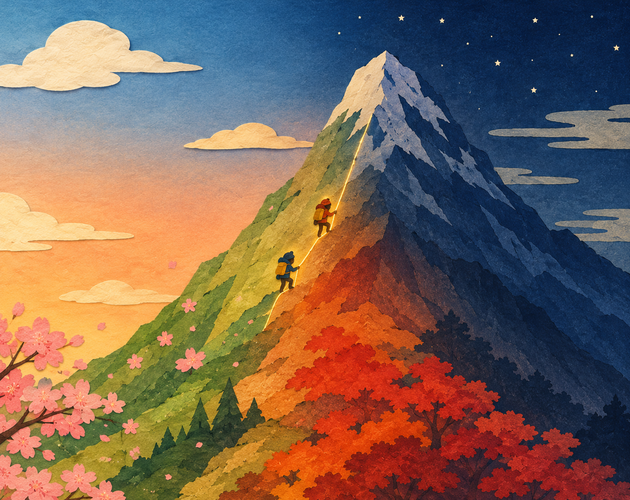

# The Kind Mountain

*You are not the climber. You are the mountain.*

An entry for [Game Off 2026](https://itch.io/jam/game-off-2026). Theme: **SHIFT**.

Two climbers, one rope, one lifetime. Hold the rope tight and they are safe but slow. Let it out and they are fast but in danger. Keep them between the two, from childhood in spring to old age in winter, and then let go. What you helped them keep becomes the poem at the top.



## How to play

The climbers move on their own. You never steer them.

| Key | What it does |
|---|---|
| Left Shift (or Space) | The rope. Hold for slow and safe, let go for fast and risky. |
| Right Shift (or Enter) | The wind. Tap to blow falling rocks aside, catch what falls, or catch a swinging climber. |
| M | Mute |
| P | Pause |

On Windows, use Space and Enter: tapping Shift five times opens the Sticky Keys prompt. Mouse and touch also work (hold the left half of the screen, tap the right half).

When both climbers are happy the rope glows gold and memories rise. Pass a keepsake while the rope is gold to keep it. Each keepsake holds one line of the ending poem.

## How it answers the theme

- The whole game is played with the two Shift keys, and it ends when you let go of Shift.
- The seasons shift, the art style shifts with each stage of life (cut paper, woodblock print, night), and the lead shifts from one climber to the other.

## Run it

It is a plain web page with no build step. Because the page loads images, open it through a local web server:

```
python3 -m http.server 8000
```

Then visit http://localhost:8000 in a browser. To publish on itch.io, zip `index.html` and the `assets` folder and upload the zip as an HTML game.

## Credits

- Design, direction and the poem "Ideas": Joseph Izampuye (SmythBook LLC)
- Built during Game Off 2026 (November 2026)

## AI disclosure

This game was made with AI assistance, and here is exactly how:

- **Code:** written with Claude (Anthropic), directed and playtested by Joseph Izampuye.
- **Images:** the four season backgrounds, the keepsake and trinket icons, and the cover were generated with ChatGPT from Joseph's prompts.
- **First design brief:** drafted with Meta Muse.
- **Drawn by code while the game runs:** the mountain wall, climbers, rope, weather, lights, and all sound and music. There are no audio files.
- **Written by a person:** the ending poem is cut from "Ideas", an original poem by Joseph Izampuye.

## Rights

Copyright 2026 Joseph Izampuye / SmythBook LLC. All rights reserved. The source is public so that others can read it, as Game Off asks.
